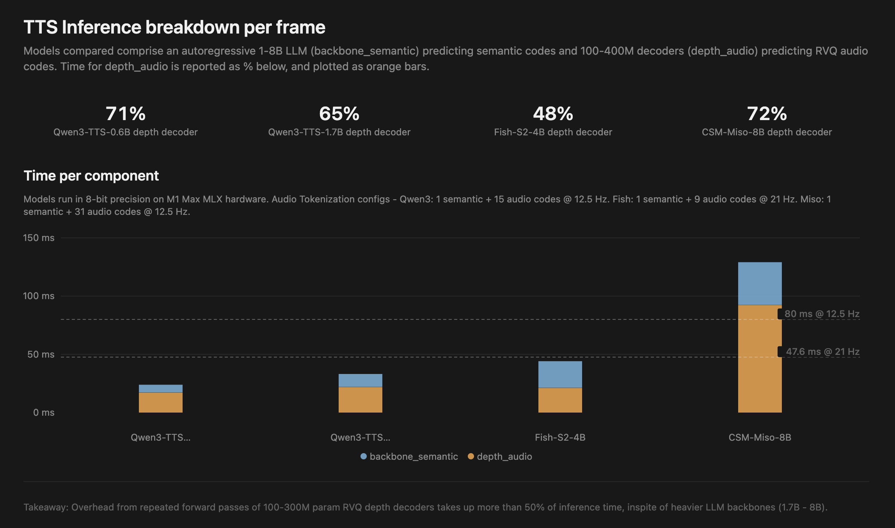

# Exploring efficient audio generation 

This project contain code for two WIP explorations on speeding up local inference of open-weight TTS models.

Most TTS/Omni-duplex models have two sub-models (1) a larger autoregressive `backbone` generating tokens corresponding to higher level semantics/prosody (2) a smaller `audio decoder`/vocoder enriching them into final raw audio with all its nuances (speaker, environment characteristics, etc).

Both aspects are explored individually below.

## Speeding up the semantic backbone: What does speculative decoding over audio sound like?

> This contains code for an upcoming blog post to be linked here.

As the semantic backbone sub-model (1) operates at a high framerate (12-25 tokens/s) - I explore how much speculative decoding can increase output tokens per step of decoding (acceptance length). As discretized audio tokens have different characteristics from sharper and less noisy text tokens, I try relaxing strict specdec acceptance criteria to look at the kind of acceptance lengths we see over audio tokens, and the impact on quality.

This is done with a local MLX implementation running on an Apple Silicon laptop using the Resemble AI [Chatterbox](https://github.com/resemble-ai/chatterbox) TTS models.

For an off-the-shelf draft/target pairing of a 100M (cbox-nano) and 500M (cbox-ar) model, we see that relaxed specdec allows us to smoothly interpolate between these two models trading off quality/speed, with surprisingly low impact to quality.

## Speeding up the audio decoder: 2x Faster Voxtral-TTS via Meanflows distillation

> This is WIP with in-flight sloppy experimental code on the `dev` branch

The audio decoder sub-model (2) forms (>50%) of local inference time for a range of popular open-weight TTS models, even though it is a lot smaller than the backbone, due to repeated forward passes at inference.

I explore [MeanFlows](https://arxiv.org/abs/2505.13447) - a distillation technique for velocity fields in the continuous latent space. Working with Mistral AI's [Voxtral TTS](https://huggingface.co/mistralai/Voxtral-4B-TTS-2603) audio decoder, we aim to bring down NFEs (number of function evaluations) from 14 to 2 for upto 2x faster local inference.

More to come here soon. Feel free to [connect/reach me](https://akashmjn.me/) if you've any thoughts!
